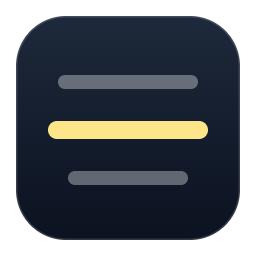

<p align="center"></p>

# Transparent Prompter Overlay

A see-through teleprompter that floats on top of every other window. Put it near your webcam and read your script while you look at the camera. You can make it hide from screen shares, so people on the call can't see it.

It runs on Windows and Linux.

## Install

1. Open the [Releases page](https://github.com/darthsalad/TransparentPrompterOverlay/releases) and download one of these:
   - `Transparent.Prompter.Overlay.Setup.1.0.0.exe` installs the app with a Start menu shortcut.
   - `Transparent.Prompter.Overlay.1.0.0.exe` is portable: it runs without installing.
2. Run it. The app is not code-signed, so Windows SmartScreen may say "Windows protected your PC". Click **More info**, then **Run anyway**.

To run from source instead, see [Run from source](#run-from-source).

## Using it

The app opens in **minimal mode**: just your script, with a few controls around it.

1. Click the text and paste or type your script.
2. Choose a mode at the top: **Manual**, **Speed** or **Voice**.
3. Press the round **play** button at the bottom.

### Minimal mode controls

| Control | What it does |
| --- | --- |
| **Drag** (top left) | Drag to move the window. |
| **Manual** | Nothing scrolls on its own. Scroll with the mouse wheel. Pressing play switches to Speed. |
| **Speed** | Scrolls at the speed set by the left slider. |
| **Voice** | Listens to you read and keeps your current line in the middle. See [Voice-follow](#voice-follow). |
| **Click-through** | Clicks pass through the overlay to the app behind it. To turn it off, press `Ctrl+Shift+F8`. |
| **Advanced** (top right) | Opens the full controls. |
| **Start over** (bottom left) | Pauses and scrolls back to the top. Your script is kept. |
| Left slider | Scroll speed (Manual and Speed modes). |
| Right slider | Background opacity. Raise it, or pick a background color in Advanced, if the text is hard to read. |
| Grip (bottom right corner) | Drag to resize the window. |

### Advanced view

**Advanced** shows everything:
- a script editor and a **Rephrase** helper that suggests simpler wording for selected text;
- **Timed** mode, which finishes the script in a duration you set, such as `03:00`;
- font size, alignment and mirrored text (for teleprompter glass);
- text color and background color, each with presets or any custom color;
- a text outline (on by default) that keeps text readable over light and dark windows alike;
- **Hide from screen sharing and recordings**.

The app opens in minimal mode every time you start it.

### Keyboard shortcuts

These work even when another app has focus.

| Shortcut | Action |
| --- | --- |
| `Ctrl+Shift+F8` | Turn click-through on or off |
| `Ctrl+Shift+F9` | Show or hide the overlay |
| `Ctrl+Shift+F10` | Play or pause |
| `Ctrl+Shift+F11` | Faster (in Timed mode: shorter duration) |
| `Ctrl+Shift+F12` | Slower (in Timed mode: longer duration) |

### Hide from screen sharing

**Hide from screen sharing and recordings** is on by default. On Windows 10 (version 2004 or later), Windows 11 and macOS, you still see the overlay, but Teams, Zoom, OBS, screenshots and recordings don't capture it. Older Windows versions capture it as a black box. It has no effect on Linux.

### Voice-follow

Voice mode listens through your microphone and matches what you say to the script. The first time you start it, the app downloads a 40 MB offline speech model. After that, it works without internet.

Limitations:
- Accuracy is modest. It works best when you speak clearly and stay close to the written words.
- It uses the microphone Windows has set as default. To change it, go to **Settings > System > Sound > Input**.
- If it loses your place, scroll with the mouse wheel. It continues from there.

### Settings

The app saves your script, window position and preferences automatically:
- Windows: `%APPDATA%\Transparent Prompter Overlay\settings.json`
- Linux: `~/.config/Transparent Prompter Overlay/settings.json`

## Run from source

You need [Node.js](https://nodejs.org/) 20 or later.

```bash
git clone https://github.com/darthsalad/TransparentPrompterOverlay.git
cd TransparentPrompterOverlay/electron
npm install
npm start
```

To build the Windows installer and portable exe into `electron/dist/`:

```bash
npm run dist:win
```

Linux notes, the project layout and developer details are in [electron/README.md](electron/README.md).

## Repository layout

- `electron/`: the app (Electron). All current work happens here.
- Repository root (`*.xaml`, `*.cs`): the original Windows-only WPF version. It is kept as a reference and is no longer developed. To run it: `dotnet run --project TransparentPrompterOverlay.csproj`.
